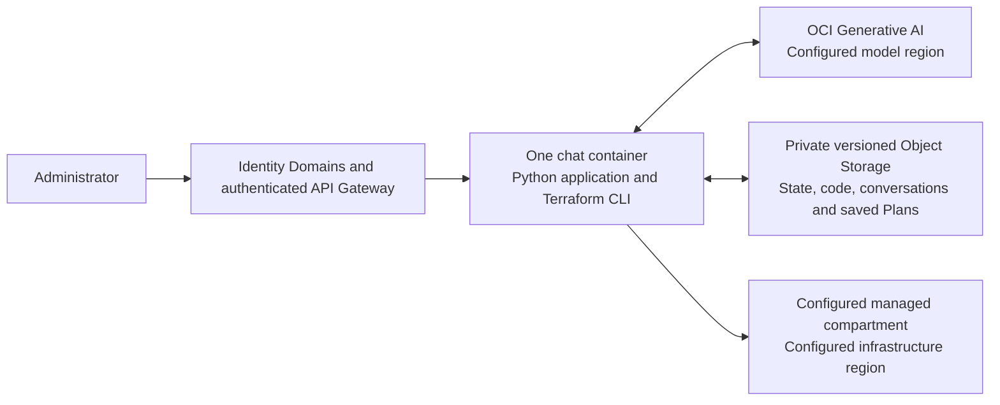

# OCI Terraform Chat

A single chat application that turns an administrator's request into reviewed Terraform changes on OCI.

The application runs continuously in one container. The model asks questions, reads a bounded set of resource metadata, and proposes code. The application owns Terraform validation, drift checks, Plan and Apply. A model response cannot execute either Plan or Apply.



## Try it

Choose one route:

- **[Run locally](docs/LOCAL_DEVELOPMENT.md):** Python and Terraform on your computer, using your own OCI API-key profile. The page listens on loopback. It still uses real OCI storage, model calls and infrastructure APIs.
- **[Deploy on OCI](docs/OCI_SETUP.md):** package the source, render your deployment files, and put the private container behind an authenticated API Gateway. The default uses a pinned public Python image with a verified source archive; a Docker build is optional.
- **[Present the demo](DEMO_RUNBOOK.md):** create a VCN, adopt an existing NLB, and resolve a manual change from chat.

This is a standalone source starter. It contains no customer credentials, deployment history, saved conversations, Terraform state or existing infrastructure identifiers. Copy the example configuration files and supply your own values.

## Chat flow

`Request → clarify → code review → Plan → Apply → result`

1. Describe the outcome and answer necessary questions in the same conversation.
2. Inspect the code diff and select **Confirm code review**.
3. Select **Create plan** and inspect the resource changes.
4. Select **Apply saved plan**. Deletes and replacements also require the exact confirmation phrase shown with that Plan.

A Plan expires after 15 minutes or when its code, workspace or live-resource checks no longer match. Apply uses the saved binary Plan; it does not silently create a different Plan.

Before every Plan, the app runs a refresh-only check. If a resource was changed outside Terraform, the administrator chooses **Keep the live value** or **Restore the code's value**. The app checks again before Apply.

## What is included

| Capability | Current implementation |
| --- | --- |
| Chat and recent context | Conversations are saved privately; the model receives the most recent 60 messages. |
| Read-only tools | `list_resources`, `get_resource`, `get_terraform_block`. |
| Resource discovery | VCNs, subnets, route tables, security lists, NSGs, Compute instances and network load balancers. |
| First-change adoption | Existing VCNs and NLBs: import block, generated configuration, deterministic cleanup and a zero-change baseline. |
| Code generation | Application-normalized OCI Terraform resource JSON, validated before review. |
| Correction | Initial draft plus at most two validation corrections. Malformed deletion instructions are fed back for correction. |
| Deletion | Already-managed resources, exact resource-address removals, matching import cleanup, Plan review and second confirmation. |
| Persistence | Native OCI Terraform backend locking plus bucket versioning; private code, conversations and Plan artifacts. |

This is not a complete OCI service catalogue. Discovery and first-change adoption have the limits shown above. It does not include a general log-troubleshooting mode, arbitrary Python or shell execution, DevOps repositories, CI pipelines, queues, an approval broker or separate Plan/Apply workers.

## Configuration and scope

The managed compartment and infrastructure region are deployment settings. The model cannot select a different compartment. The model's processing region can be configured independently: the example uses direct `openai.gpt-oss-120b` access in Frankfurt.

Check [OCI model availability by region](https://docs.oracle.com/en-us/iaas/Content/generative-ai/model-endpoint-regions.htm) before choosing a model location. A regional model listing can mean dedicated-only availability; it does not always mean on-demand access.

See [configuration](docs/CONFIGURATION.md) for each setting and [architecture](docs/ARCHITECTURE.md) for the execution boundaries.

Run **one application instance per workspace and state key**. The application serializes workspace operations in one process. Multiple replicas are not supported by this starter.

## Versions and checks

- Python 3.11
- Terraform CLI 1.13.5
- OCI Terraform provider 9.11.0
- OCI Python SDK 2.187.1
- `python-hcl2` 7.3.1

The Docker build verifies the Terraform download against the bundled release checksum. The application pins the OCI provider version.

```bash
python3.11 -m venv .venv
source .venv/bin/activate
python -m pip install -r requirements.txt
python -m unittest discover -s tests -v
python -m unittest discover -s deploy -p 'test_*.py' -v
```

If Node.js is installed, run the browser-control logic tests too:

```bash
node --test tests/ui_state.test.cjs
```

Real Terraform parser tests run when `terraform` is on `PATH`; the test report identifies any skipped integration check. Unit tests do not provision infrastructure. Passing local checks does not establish that a new customer's OCI tenancy, identity setup or native Plans have been verified.

## Operating notes

Use a dedicated managed compartment and a fresh private, versioned bucket. The broad proof-of-concept IAM rules are deliberately compartment-scoped. This trial trusts the application and its operators; the approval buttons do not constrain someone who has compromised the runtime credential. OCI charges for the running container, Gateway, storage, model usage and any resources you choose to provision.

State, Plan artifacts and conversations have **no automatic retention cleanup** in this starter. Plan expiry disables Apply; it does not delete the saved objects. See [troubleshooting and maintenance](docs/TROUBLESHOOTING.md).

The code is provided under the [MIT License](LICENSE). Third-party dependencies retain their own licenses. This is a community starter, not an Oracle product or an endorsement.
